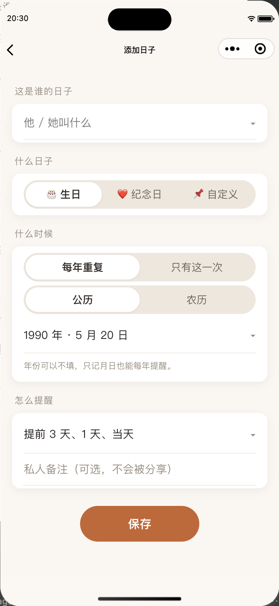
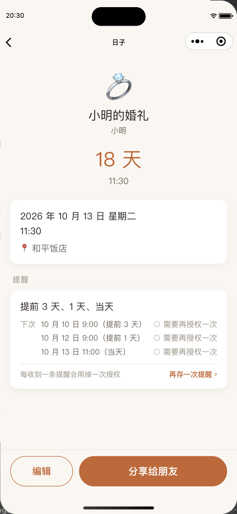

# 日有所念 · day-memory

> 记住重要的人，别忘了重要的日子。
>
> Remember the days that matter.

**日有所念**是一款以「人」为中心的微信小程序，用来记录亲友的生日、纪念日和人生大事。这个仓库保存小程序的公开宣传网页与展示素材。

**访问官网：[days.zfdang.com](https://days.zfdang.com/)**

## 打开小程序

在微信中搜索 **「日有所念」**，或使用微信扫描下方小程序码：


手机上也可保存图片，再在微信「扫一扫」中从相册选择。

## 能帮你记住什么

- **重要的人与日子**：在亲友名下记录生日、纪念日、婚礼、毕业和乔迁等日子。
- **农历与公历**：按习惯选择日期，小程序自动计算下一次发生的日子，不必每年重新换算。
- **微信订阅提醒**：提前为祝福、礼物和相聚留出准备时间，并查看提醒状态。微信一次性订阅消息每授权一次可发送一条提醒，可在小程序内补充次数。
- **分享与一起记得**：将日子或亲友卡片分享给家人朋友；对方添加独立副本后，可自行设置提醒。私人备注不会随分享公开。

## 界面预览

以下为小程序测试环境的真实截图，展示内容为示例，部分界面可能与当前版本不同。

<p>
  
  
  
</p>

## 网站目录

网页使用原生 HTML、CSS 和 JavaScript，无需安装依赖或构建。

```text
index.html          宣传页内容
styles.css          桌面与手机样式
script.js           复制小程序名称等交互
assets/
  mark.svg          网页标识
  gh_50407419f4dd_860.jpg  正式小程序码
  screenshots/      小程序界面截图
CNAME               自定义域名
LICENSE             许可证
```

## 本地预览

在本仓库根目录运行：

```sh
python3 -m http.server 4173 --bind 127.0.0.1
```

打开 [本地预览](http://127.0.0.1:4173/)。

## 维护与发布

1. 网页原稿在小程序项目的 `pages/` 目录中维护，先完成修改并预览确认。
2. 将确认后的 `index.html`、`styles.css`、`script.js` 和 `assets/` 同步到本仓库根目录；不要同步整个小程序项目或覆盖本仓库的 `README.md`、`CNAME` 与 `LICENSE`。
3. 提交更改并创建 Pull Request，检查通过后由维护者合并。
4. GitHub Pages 从 `main` 分支根目录自动发布，通过 [days.zfdang.com](https://days.zfdang.com/) 访问。可在仓库的 Actions 中查看发布进度。

更新展示截图时，请使用测试数据，保留必要的版本说明，避免包含真实用户的私人信息。

## 许可证

本仓库采用 [GNU Affero General Public License v3.0](LICENSE)。
